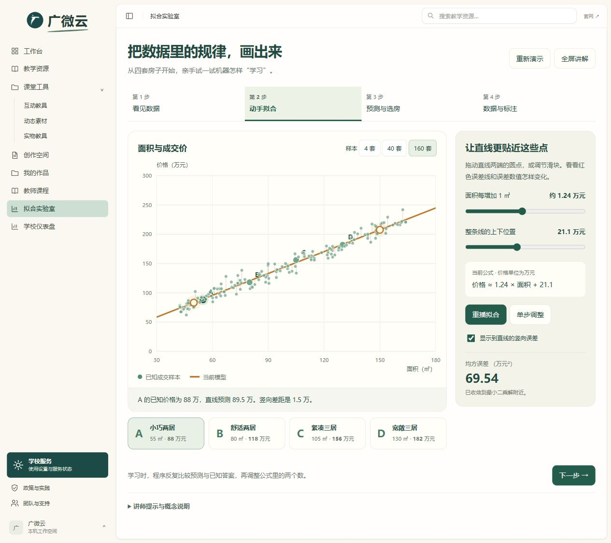

# 广微云 · 拟合实验室

用房屋面积与成交价，交互演示数据、拟合、预测和标注质量。适合教师 AI 通识培训，支持电脑、投屏、平板和手机。

**[打开在线模拟器](https://echowu1024.github.io/guangweiyun-fitting-lab/)** · **[下载独立 HTML](https://echowu1024.github.io/guangweiyun-fitting-lab/广微云_拟合实验室.html)**

## 四步演示

1. **看见数据**。点选四套示例房子，在坐标图上对应面积和成交价，再切换到 40、160 个样本。
2. **动手拟合**。拖动直线两端、调节斜率和截距，观察竖向误差。使用自动学习、暂停、单步调整展示梯度下降。
3. **预测与选房**。输入新面积，沿直线读取预测价格。根据面积和预算寻找样本中符合条件的房源。
4. **数据与标注**。把 C 的价格误标为 260 万，观察重新拟合的结果，再恢复正确标签。

界面提供全屏和讲师提示。房源全部为课堂虚构样本。模型采用一元线性回归，最小化竖向预测误差平方和。计算在浏览器本地完成。



## 本地运行

可以直接双击 `dist/index.html`，或双击 `downloads/广微云_拟合实验室.html`。

需要本地预览服务时，安装 Node.js 20 或更新版本后运行下面的命令。

```bash
git clone https://github.com/echowu1024/guangweiyun-fitting-lab.git
cd guangweiyun-fitting-lab
npm start
```

打开 `http://127.0.0.1:4175`。按 `Ctrl+C` 关闭服务。

## 修改源码

|文件|用途|
|---|---|
|`src/fitting.js`|四步交互、坐标绘制、拖动与演示流程|
|`src/fitting-math.js`|示例数据、最小二乘解、梯度下降与房源筛选|
|`src/fitting.css`|排版、绿色主题和响应式样式|
|`src/index.html`|独立网页入口|
|`src/assets/logo.jpg`|广微云品牌标志|
|`scripts/build.cjs`|生成网页目录和可双击的独立 HTML|
|`tests/math.cjs`|拟合数值、误差下降、筛选和独立 HTML 检查|
|`.github/workflows/pages.yml`|主分支测试和 GitHub Pages 自动发布|

修改 `src/` 中的文件，然后构建、检查并预览。

```bash
npm run build
npm test
npm start
```

推送到 `main` 后，GitHub Actions 自动构建和检查，成功后更新在线页面。小伙伴可以 Fork 仓库、修改后提交 Pull Request。`dist/` 和 `downloads/` 由源码生成。

## 参考

分步交互节奏参考 [汽车智能体解剖台](https://github.com/xman61/agent-car-anatomy)。拟合模拟器的源码由广微云项目独立实现。

数学说明参考 [NIST 最小二乘说明](https://www.itl.nist.gov/div898/handbook/pmd/section4/pmd431.htm)。页面内“讲师提示与概念说明”提供授课建议与数据标签说明。
